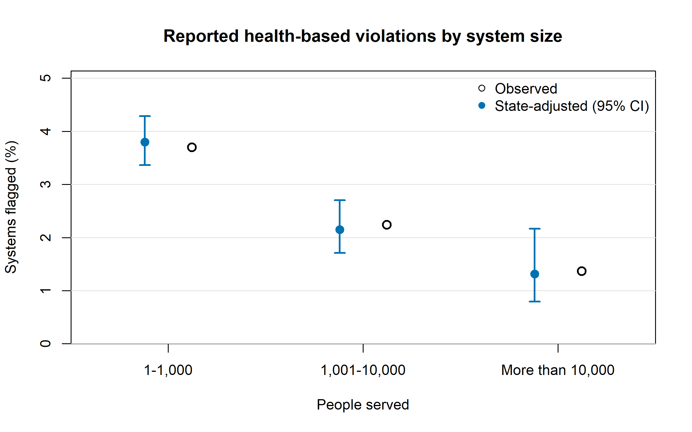

[drinking-water-compliance-readme.md](https://github.com/user-attachments/files/34958271/drinking-water-compliance-readme.md)
# drinking-water-compliance
# Drinking Water Compliance in the Great Lakes States

**How common are reported health-based drinking water violations, and does the percentage of systems with a violation vary by state or by the number of people they serve?**

This project will build an interactive Power BI dashboard that lets residents and regional program managers explore that question. For each comparison, readers will see both the percentage and the number of water systems behind it.

## Data and scope

The project uses the U.S. Environmental Protection Agency’s public Drinking Water System Search dataset. Each row represents one public water system, identified by its Public Water System ID (`PWSID`). The analysis focuses on active community water systems in Illinois, Indiana, Michigan, Minnesota, New York, Ohio, Pennsylvania, and Wisconsin. It covers these eight states in full, using state boundaries. System size is based on the number of people served.

[EPA ECHO data download](https://echo.epa.gov/tools/data-downloads#drinking-water-data-downloads) · [EPA data dictionary](https://echo.epa.gov/tools/data-downloads/sdwa-facility-search-download-summary)

## How the measure works

A health-based violation involves a drinking water standard for contaminants, disinfectants, or required treatment practices. The analysis will use EPA’s health-based violation indicator (`HEALTH_FLAG`) and document its coding and reporting window for the downloaded release before calculating results.

For each state or system-size group, the percentage is the number of systems flagged for a health-based violation divided by the number of eligible systems with a known flag, multiplied by 100. For example, 5 flagged systems out of 100 with known flags would be reported as **5%**. The dashboard will show missing flags separately and leave the percentage blank when no flags are known.

Each system counts once, regardless of how many people it serves or how many violations it has. The measure describes the share of systems flagged. Small groups can show large percentage changes from just one additional flagged system. Reporting delays and incomplete records can affect comparisons, and the dashboard summarizes a reporting snapshot. For current local water quality information, contact your water system.

[EPA search results guide](https://echo.epa.gov/help/facility-search/drinking-water-search-results-help) · [EPA drinking water data FAQs](https://echo.epa.gov/help/sdwa-faqs)

## Work plan

| Milestone | Estimated effort | Deliverable |
| --- | --- | --- |
| Week 1 | 3–4 hours | Source note, data audit, and counts of eligible systems, flagged systems, and missing flags by state and system size |
| Week 2 | 4–5 hours | Reproducible R analysis comparing observed percentages with estimates from a logistic regression that accounts for state and system size together |
| Week 3 | 4–5 hours | Power BI dashboard with a headline finding, state and system-size filters, and the counts behind each percentage |

The regression will show whether patterns by system size persist after accounting for differences across states, and whether patterns by state persist after accounting for system size. These comparisons describe associations in the reported data. An AWS pipeline is a follow-on milestone once the local workflow is reproducible.

## Getting started

1. Create the repository and add this file as `README.md`.
2. Download the **Drinking Water System Search Dataset** from EPA ECHO, extract `SDWA_SYSTEM_SEARCH.csv`, and record the download date.
3. In RStudio, count the rows and unique system IDs, check for duplicate or missing IDs, and tabulate all `HEALTH_FLAG` values, including missing values. Record the results before filtering or recoding.

Keep the source ZIP and CSV local. Commit the audit script and source note so others can reproduce the analysis using the EPA download.

In our case, the download date is 11/17/2026

### Reported health-based violations by system size



*Among systems that reported serving at least one person, the percentage flagged for a health-based violation was lower in each successively larger size group. The pattern held after accounting for differences across states. Open circles show observed percentages. Filled circles show state-adjusted estimates, and error bars show their 95% confidence intervals.*

**Systems reporting zero people served.** Of the 17 systems in this group, none were flagged for a health-based violation (0 of 17, 0%).

### Power BI dashboard


*The screenshot shows the all-eight-state view. The observed percentage was 3.05% (342 of 11,202 systems with a positive reported population and a known flag). In the Power BI report, the state slicer filters the observed results, and the adjusted chart shows estimates for all eight states.*

**Systems reporting zero people served.** Across all eight states, 0 of 17 systems in this group were flagged.

## Methods and limitations

### Observed percentages

The analysis includes active community water systems in Illinois, Indiana, Michigan, Minnesota, New York, Ohio, Pennsylvania, and Wisconsin. Each system contributes once. The observed percentage is the number flagged Yes for a reported health-based violation divided by the number with a Yes or No flag, multiplied by 100.

The size analysis includes 11,202 systems with a positive reported population. Project-defined size groups are 1–1,000, 1,001–10,000, and more than 10,000 people served.

### State adjustment and confidence intervals

We fitted a logistic regression with violation flag as the outcome and size group and state as categorical predictors. The model allows baseline odds to differ across states and estimates a common size-group association across states.

Adjusted percentages use direct standardization. For each size group, we predicted probabilities using the states of all 11,202 systems, then averaged those probabilities. Each adjusted estimate therefore uses the same state mix, weighted by the number of eligible systems in each state.

The 95% confidence intervals were calculated using the delta method and the model coefficient covariance matrix, with limits transformed through the log-odds scale to stay between 0% and 100%. These are model-based intervals around each adjusted percentage, treating the state mix as fixed.

### Limitations

The results describe associations in a reporting snapshot. Reporting delays, incomplete records, and differences in reporting practices may affect comparisons. Adjustment accounts for state and size group, while other system characteristics may also influence violations.

Observed patterns varied across states, and the fitted model assumes a common size-group association. The largest group had only 15 flagged systems. Its direct comparison with the middle group was uncertain (adjusted OR 0.605, 95% CI 0.345–1.060).

The confidence intervals reflect uncertainty under the fitted model. Reporting errors, model misspecification, and variation in reporting practices require separate consideration.


## Reproduce the analysis

The script uses base R and requires no additional packages.

1. Download and extract this repository using Code → Download ZIP.
2. Download and extract `SDWA_SYSTEM_SEARCH.csv` from the EPA ECHO Drinking Water System Search dataset.
3. Open `analysis.R` in RStudio.
4. Choose Session → Set Working Directory → To Source File Location.
5. Click Source and select the EPA CSV when prompted.

The script regenerates the figure in `figures/` and these summary files in `power_bi_exports/`:

- `observed_by_state.csv` — state totals, including systems reporting zero population.
- `observed_by_size.csv` — the three positive population size groups.
- `observed_by_state_and_size.csv` — positive size groups within each state.
- `adjusted_by_size.csv` — state-adjusted percentages and 95% confidence limits.
- `reported_zero_by_state.csv` — reported-zero population results by state.

CSV percentages use a 0–100 scale. Blank percentages indicate a zero known-flag denominator. The published results used EPA data downloaded on November 17, 2026. Later releases may produce different results.

See the [data provenance note](metadata/data-source.md) for the source and reporting limitations, the [input-file record](metadata/input_file.csv) for the file fingerprint, and the [R session information](metadata/session-info.txt) for the software environment used.

## Reproduce the DuckDB SQL comparison

This local workflow uses R, DBI, and DuckDB.

1. Install the required packages once in the RStudio console:

   ```r
   install.packages(c("DBI", "duckdb"))
   ```

2. Run `analysis.R` to regenerate the R summaries.
3. Open `duckdb_analysis.R` and set the working directory to its location.
4. Click Source and select the original `SDWA_SYSTEM_SEARCH.csv` at the single file prompt.

The script automatically reads these R summaries from `power_bi_exports/` in the working directory:

- `observed_by_size.csv`
- `observed_by_state_and_size.csv`
- `reported_zero_by_state.csv`

Run `analysis.R` first so these comparison files are available.

The script queries the original EPA CSV and compares its SQL summaries with the R exports. The state-by-size comparison matches all 24 rows on both state and size group, checks for unique matching keys, and compares five numeric columns. Counts must match exactly; rounded percentages use a tolerance of 1e-10.

Successful runs print these messages:

- `R and SQL summaries match, including the separate reported-zero totals.`
- `All 24 state-by-size rows match the R summary.`
- `State-by-size SQL exports verified.`

### SQL outputs and comparison records

The script regenerates ten files in `sql_exports/`:

| File | Data rows | Contents |
|---|---:|---|
| `observed_by_size_sql.csv` | 3 | Positive population size groups |
| `r_vs_sql_size_checks.csv` | 4 | Size-summary column comparisons |
| `observed_by_state_and_size_sql.csv` | 24 | Positive size groups within each state |
| `r_vs_sql_state_size_checks.csv` | 5 | State-by-size column comparisons |
| `reported_zero_totals_sql.csv` | 1 | Separate reported-zero totals |
| `r_vs_sql_zero_checks.csv` | 3 | Separate reported-zero metric comparisons |
| `parquet_positive_validation.csv` | 1 | Positive-population Parquet counts |
| `parquet_zero_validation.csv` | 1 | Reported-zero Parquet counts |
| `parquet_positive_record_checks.csv` | 1 | Positive-population record comparisons |
| `parquet_zero_record_checks.csv` | 1 | Reported-zero record comparisons |

The positive-size summaries total 342 flagged systems out of 11,202 known flags in the published snapshot. R-versus-SQL comparison files contain TRUE for matching results. Parquet record-check files contain 0 missing and 0 extra records.

### Parquet outputs and validation

Running duckdb_analysis.R also generates two ZSTD-compressed Parquet files locally in data/processed/:

- positive_population.parquet contains 11,202 systems with positive whole-number populations.
- reported_zero_population.parquet contains 17 systems reporting zero people served.

Both files contain system ID, state, health flag, and population. The script queries the saved files and checks their violation counts against the SQL summaries.

Bidirectional EXCEPT ALL comparisons check every record across all four fields, preserving duplicate counts. Both files returned 0 missing and 0 extra records.

[View Parquet validation](metadata/parquet-validation.md)

### Reported-zero Parquet results

Reported-zero populations have their own Parquet file and validation exports. The published snapshot contains 0 flagged systems out of 17, with 0 missing flags.

### Reported-zero SQL results

Reported-zero totals are saved in `reported_zero_totals_sql.csv`, with 0 flagged out of 17 systems in the published snapshot. Their comparisons are recorded separately in `r_vs_sql_zero_checks.csv`.

[View the comparison results](metadata/r-vs-sql-validation.md)

### Reported-zero population results

The published snapshot contained 17 systems reporting zero people served, with 0 flagged. These results are exported separately in `reported_zero_by_state.csv`. The positive-size summaries and regression use 11,202 systems with a positive reported population.

[Download EPA data](https://echo.epa.gov/tools/data-downloads#drinking-water-data-downloads)

[EPA data dictionary](https://echo.epa.gov/tools/data-downloads/sdwa-facility-search-download-summary) · [EPA reporting caveats](https://echo.epa.gov/help/sdwa-faqs)


## Explore the Power BI report

Download [the Power BI report](power_bi/drinking-water-compliance.pbix) and open it in Power BI Desktop.

### Reconnect the CSV sources on another computer

1. Download the repository using Code → Download ZIP and extract it.
2. Open `power_bi/drinking-water-compliance.pbix` in Power BI Desktop.
3. Select Home → Transform data.
4. Select a query, then click the gear beside Source under Applied Steps.
5. Browse to the matching CSV in the extracted repository’s `power_bi_exports` folder.
6. Repeat for all five queries using the table below.
7. Select Home → Close & Apply, then save the report.

| Query | CSV in `power_bi_exports` |
|---|---|
| `observed_by_state` | `observed_by_state.csv` |
| `observed_by_size` | `observed_by_size.csv` |
| `observed_by_state_and_size` | `observed_by_state_and_size.csv` |
| `adjusted_by_size` | `adjusted_by_size.csv` |
| `reported_zero_by_state` | `reported_zero_by_state.csv` |

If Source has no gear icon, select the Source step and enable View → Formula bar. Replace the old path inside `File.Contents("...")` with the full path to the matching CSV on your computer.

After loading the CSVs, clear the state slicer. With the published summary files, the cards should show 3.05%, 342 flagged systems, and 11,202 systems with known flags. The adjusted chart should show 3.80%, 2.15%, and 1.31%.

To refresh after rerunning `analysis.R`, reconnect to its regenerated CSVs if their location changed, then select Home → Refresh. Findings text and screenshots should also be reviewed when the data changes.

### Check the reported-zero results

`reported_zero_by_state.csv` remains a separate query with eight rows. In the published snapshot, it totals 0 flagged systems out of 17 systems reporting zero people served. These results appear in their own report note.

The positive-size summaries and adjusted estimates cover 11,202 systems. The overall state summary includes all 11,219 eligible systems.

The state slicer filters the observed chart, cards, and matrix. The adjusted chart shows estimates standardized to the full eight-state mix.


### Release validation

The project author completed a fresh-download reproduction check of v1.0.0 on November 19, 2026, including the R analysis and Power BI refresh. See the [validation record](metadata/release-validation-v1.0.0.md) for the verified results and separate reported-zero summary.


The project author also completed a fresh-download check of the local DuckDB extension in preparation for v1.1.0. See the [validation record](metadata/release-validation-v1.1.0.md), including the separate reported-zero comparisons.


The project author completed a fresh-download check of the Parquet extension in preparation for v1.2.0, regenerating 10 SQL CSV exports and two Parquet files. See the [preparation check](metadata/release-validation-v1.2.0.md), including the separate reported-zero results.


## Run the complete local pipeline

Install DBI and duckdb once in RStudio. In PowerShell, open the repository folder and run:

```powershell
# Replace both paths with your local locations.
.\run_pipeline.ps1 -CsvPath 'C:/path/to/SDWA_SYSTEM_SEARCH.csv' -RscriptPath 'C:/path/to/Rscript.exe'
```


If a downloaded runner is blocked as unsigned under RemoteSigned, review `run_pipeline.ps1`, then unblock that specific file in the project folder:

```powershell
# Remove the download block from the reviewed runner.
Unblock-File -LiteralPath .\run_pipeline.ps1
```

If script execution is disabled in the current session, use `Set-ExecutionPolicy -Scope Process -ExecutionPolicy RemoteSigned` before running the command. Organization-managed policies may take precedence.

[Two-run v1.3.0 preparation check](metadata/release-validation-v1.3.0.md)

The runner regenerates the R summaries, SQL exports, Parquet files, figure, and metadata. Refresh Power BI afterward.

[Repeatability check](metadata/pipeline-repeatability.md)

### Reported-zero results

Reported-zero outputs remain separate, with 0 of 17 flagged in the published snapshot.


